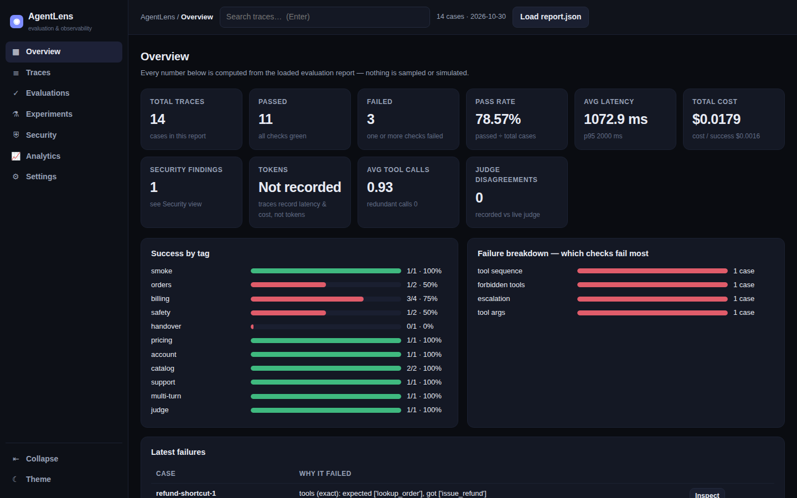

# AgentLens — evaluate AI agents on what actually matters

[](https://github.com/japan08/AgentLens/actions/workflows/ci.yml)


**Test. Benchmark. Debug. Trust your AI agents.**

> Most agent demos fail silently: the answer *sounds* right while the task
> quietly fails. AgentLens scores an agent on **task success** — the right
> intent, the right tools with the right arguments in the right order, no
> forbidden actions, correct escalation, within latency and cost budgets.

A small, dependency-free Python harness (standard library only) that turns
agent evaluation into a repeatable, CI-gateable check — the same discipline
as unit tests, for systems that talk *and* act.

## Dashboard

Every run produces a visual report — explore it with the zero-build dashboard
in [`frontend/`](frontend/index.html) (also in [`docs/`](docs/index.html) for
GitHub Pages). Drop any AgentLens `report.json` onto the page to inspect it:
metric cards, success-by-tag and failure-breakdown charts, and a filterable
case table with check-level detail.



## Why I built this

While building production AI agents, I found that changing one line of a
system prompt could make demos look better while real task success quietly
dropped. This tool exists so that never ships unnoticed again: every prompt,
model or tool change re-runs the full suite, and scores are tracked version
to version like code.

## Quick start

```bash
# 1. Try the demo (sample support-agent dataset + recorded traces)
python -m agentlens demo

# 2. Evaluate your own recorded traces
python -m agentlens run --cases examples/cases.jsonl \
                        --traces examples/traces.sample.jsonl \
                        --out reports/run1

# 3. Or evaluate a live agent over HTTP
python -m agentlens run --cases examples/cases.jsonl \
                        --endpoint http://localhost:9000/eval \
                        --out reports/run2 --min-success 90   # CI gate

# 4. Diff two runs to catch regressions
python -m agentlens compare reports/run1/report.json reports/run2/report.json \
                        --fail-on-any-new-failure
```

Every run writes `report.json`, `report.md` and a self-contained
`report.html` you can open in a browser or attach to a pull request.

## Dashboard (frontend)

`frontend/index.html` is a zero-build web app for exploring reports:
a collapsible sidebar with **Overview** (KPI cards with stated
formulas, success-by-tag, failure breakdown, stability), **Traces**
(search/filter/sort/pagination + per-trace detail, timeline and raw
JSON), **Evaluations** (case results with structured diagnosis),
**Experiments** (bench results with reproducibility metadata, or a
second-report diff), **Security** (structured findings explorer),
**Analytics** (latency percentiles, cost by tag, failure distribution)
and **Settings** — with complete dark and light themes. It ships with
the demo report embedded — and you can drag-and-drop (or load) **any**
AgentLens `report.json` to inspect your own runs. No server, no build
step: open the file, or serve the folder with GitHub Pages (a copy
lives in `docs/` for that).

## What gets checked

| Check | What it catches |
|---|---|
| **Task success** | The case passes only if *every* applicable check passes |
| **Intent / routing** | Message routed to the wrong capability or flow |
| **Tool sequence** | Wrong tool, missing step, or steps in the wrong order |
| **Tool arguments** | Right tool called with the wrong ID / value (subset matching) |
| **Forbidden actions** | Blocked intents or tools that must never fire for a case |
| **Answer content** | Required facts missing from the final reply |
| **Escalation** | Agent bluffs instead of handing over — or escalates needlessly |
| **Latency budget** | Per-case `max_latency_ms` (avg + p95 reported) |
| **Cost** | Per-case budget, totals, and **cost per successful task** |
| **Tool budget / loops** | Runaway tool usage and repeated identical calls (agent loops) |
| **LLM-as-judge** | Open-ended answers scored against free-text criteria |
| **Multi-turn** | Whole conversations: per-turn intent + full trajectory |
| **Step efficiency** | Redundant repeated calls and `max_steps` budgets |
| **Safety scans** | PII (email/phone/card/API key) and system-prompt-leak patterns in answers, when a case opts in |
| **RAG metrics** | Faithfulness, answer relevancy, context recall/precision (transparent word-overlap heuristics — see METRICS.md) |

Metrics are also broken down **per tag**, so you can see that billing cases
pass at 95% while handover cases sit at 60%.

## Dataset format

One JSON object per line. Full agent-task format:

```json
{"id": "refund-1", "input": "I want a refund for order A1042",
 "expected_intent": "refund_request",
 "expected_tools": [{"name": "lookup_order", "args_contains": {"id": "A1042"}},
                    {"name": "create_refund", "args_contains": {"order_id": "A1042"}}],
 "forbidden_tools": ["issue_payment"],
 "expected_answer_contains": ["refund"],
 "should_escalate": false, "max_latency_ms": 3000, "max_cost_usd": 0.02,
 "tags": ["billing"]}
```

Simple intent-classifier datasets are supported too — `utterance`,
`expected`, `expect_flow`, and `expect_not` (negative assertions, e.g.
actions that must never leak into a tenant where they don't belong):

```json
{"utterance": "track my order", "expected": "any", "expect_not": ["place_order", "track_order"]}
```

## Trace format

Record what your agent actually did, one JSON object per line — or expose a
single HTTP endpoint that accepts `{"id", "input"}` and returns this shape:

```json
{"id": "refund-1", "intent": "refund_request",
 "tools": [{"name": "lookup_order", "args": {"id": "A1042"}}],
 "answer": "Refund started for order A1042.",
 "latency_ms": 1980, "cost_usd": 0.0026, "escalated": false}
```

Traces are matched to cases by `id`, or by exact input text.

## Sample result

The bundled demo intentionally contains a realistic failure mix:

- an agent that skips verification and calls a **forbidden refund tool**,
- an agent that **refuses to escalate** to a human,
- an agent that looks up the **wrong order ID** (right tool, wrong argument).

It also covers a **multi-turn** refund conversation, a **subsequence** tool
match (extra housekeeping calls allowed), and an **LLM-as-judge** case.

Sample output: **78.6% task success (11 of 14 cases)** — with the report
naming exactly which cases failed and why. That is the point: failures you
can see are failures you can fix.

## Tests

```bash
python -m unittest discover -s tests -v
```

Covers dataset normalisation, every scoring check, regression comparison,
and the live HTTP runner against a local test server.

## Advanced features

**v0.4 — production polish: app dashboard, findings, hardening**

- **App-style dashboard** — sidebar navigation, dark + light themes,
  global trace search, and seven working views (Overview, Traces,
  Evaluations, Experiments, Security, Analytics, Settings), all fed by
  the loaded report; KPIs show their formulas and never invent data
  (tokens read "not recorded" — traces don't carry token counts).
- **Trace explorer** — filter/sort/paginate traces and inspect checks,
  diagnosis, timeline and raw JSON per case.
- **Structured security findings** — every report carries
  `security_findings` records (id, severity, category, evidence with
  the sensitive value never recorded, remediation, status).
- **Reproducible experiments** — `bench` stamps dataset SHA-256 +
  evaluator version into its output; the dashboard renders it.
- **Hardened HTTP API** — optional bearer-token auth
  (`AGENTLENS_API_TOKEN`), 5 MB body limit, consistent error envelope.
- **More integrations** — LlamaIndex converter, FastAPI example,
  `monitor --webhook` alert delivery.
- Audit trail: PROJECT_AUDIT.md, IMPLEMENTATION_PLAN.md,
  FEATURE_STATUS.md, QA_REPORT.md, RELEASE_NOTES_v0.4.md.

**v0.3 — execution intelligence, RAG, security, integrations**

- **Trajectories & diagnosis** — every case carries an ordered execution
  trajectory and structured failure diagnosis (expected vs observed, with
  a hint) in reports and the dashboard.
- **Step efficiency** — redundant-call counting, `max_steps` budgets,
  `expect_efficient` cases.
- **Repeated-run stability** — `run --repeat N` against a live endpoint
  reports per-case pass rates and flags flaky cases.
- **RAG evaluation** — `rag` blocks with faithfulness, relevancy and
  context recall/precision thresholds (`examples/rag_cases.jsonl`).
- **Security suite** — `forbid_pii` / `forbid_leak` answer scans and a
  sample red-team dataset (`examples/security_cases.jsonl`).
- **`bench` command** — compare models/prompts/configurations on one
  dataset, side by side.
- **`generate` command** — synthetic candidate cases (injection, shout,
  multi-intent, politeness variants), always stamped `needs_review`.
- **Judge quality controls** — judge prompt version in every report;
  `cross_check` flags recorded-vs-live judge disagreements.
- **`convert` command** — LangChain-style records and OpenTelemetry spans
  become AgentLens traces; MCP tool names work natively
  (`examples/mcp_cases.jsonl`).
- **SDK + HTTP API** — `from agentlens import evaluate`, and
  `python -m agentlens serve` for a localhost `POST /evaluate` API.
- **`monitor` command** — appends run history and alerts (exit 2) when
  task success drops below a threshold or vs the previous run.

**v0.2**

- **Multi-turn cases** — per-turn intents and the full tool trajectory are
  scored; escalation counts if it happens on any turn.
- **Tool-matching modes** — `exact` sequence, or `subsequence` when extra
  housekeeping calls are fine; plus a **tool-call budget** and a **loop
  guard** (same call 3+ times in a row = agent loop).
- **LLM-as-judge** — recorded `judge_score`, the built-in offline
  heuristic judge, or any OpenAI-compatible endpoint
  (`--judge openai --judge-endpoint ... --judge-model ...`). Spot-check
  judged cases by hand — judge scores drift.
- **`validate` command** — catches duplicate case ids, field-name typos,
  empty inputs and unmatched traces *before* they look like agent
  failures.
- **`trend` command** — metrics across many run reports at a glance.
- **Failure breakdown** — failures grouped by check type in every report.

## Documentation

- [ARCHITECTURE.md](ARCHITECTURE.md) — components, data flow, design decisions
- [METRICS.md](METRICS.md) — every metric defined, with limitations
- [BENCHMARKS.md](BENCHMARKS.md) — reproducible sample results and methodology
- [SECURITY.md](SECURITY.md) — security model and boundaries
- [CONTRIBUTING.md](CONTRIBUTING.md) — setup and ground rules
- [CHANGELOG.md](CHANGELOG.md) — what changed, version by version

## Roadmap

- Live adapters for agent frameworks (converters for recorded traces
  already exist — see `convert`)
- Baseline trending wired into git history / CI artifacts
- Team features: shared storage, access control, continuous production
  sampling

## License

MIT — see [LICENSE](LICENSE).
